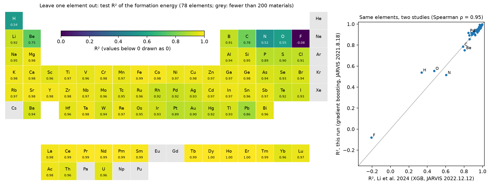

# Materials ML Primer


**Latest result.** For materials from new chemical systems or new structure types, a formation-energy model has 1.3 to 1.9 times the error that a random train/test split reports, and the elements whose compounds are hardest to predict without having seen them are the same in two independent studies. [Explore the results interactively](https://shuruyue.github.io/Materials-ML-Primer/web/data_splits.html) or read the [experiment](experiments/data_splits/).

[](https://shuruyue.github.io/Materials-ML-Primer/web/data_splits.html)

Small, tested building blocks for machine learning on crystal structures, and experiments that ask how far each one can be trusted. Every method is first shown to be correct against something independent (**verification**: closed forms, symmetry invariants, reference software), then applied to real data and compared with published results (**validation**). The recurring question is the one every materials ML result has to answer: how well does the model do on materials unlike the ones it was trained on, and does it know when it is unreliable?

Every experiment is sized to run in hours, not days, on a single 12 GB consumer GPU.

## Reading order

| Order | Experiment | Question | Code | Status |
|---|---|---|---|---|
| 1 | [crystal_graphs](experiments/crystal_graphs/) | How is a periodic crystal turned into a graph, and how do we know the neighbor list is right? | `graphs` | done: shells of six structures equal exact lattice sums; 19 770 edges identical to pymatgen; 55 tests |
| 2 | [baselines](experiments/baselines/) | How far do composition and structure descriptors with random forests and gradient boosting get? | `data`, `descriptors` | done: gradient boosting on 150 features reaches 0.076 eV/atom (formation energy) and 0.198 eV (band gap) on JARVIS-DFT; published CFID baseline reproduced (0.135 vs 0.14 eV/atom); 149 tests |
| 3 | [data_splits](experiments/data_splits/) | How much does a random train/test split overstate accuracy compared with chemistry- and structure-aware splits? | `splits` | done: formation-energy MAE 0.076 eV/atom (random) rises to 0.097 (chemical systems held out), 0.145 (structure prototypes) and 0.109 (materials added to JARVIS after 2021); the elements hardest to hold out (F, N, H, O, Be, C) are those of Li et al. 2024 (Spearman 0.95 over 78 elements); 67 tests |
| 4 | [uncertainty](experiments/uncertainty/) | Can a model tell when its prediction is unreliable? Ensembles, quantile regression, random forests, Gaussian processes, deep ensembles and conformal intervals, under distribution shift | `uncertainty` | done: conformal 90 % intervals cover 0.897–0.902 on random and chemical-system splits but 0.71–0.81 with an element held out (0.14 for fluorine compounds); the random forest's spread ranks errors best (Spearman 0.59–0.64 on all splits) but only 0.43 within an unseen element; bootstrap standard deviations are 2.5–3.8 times too small; 16 tests |
| 5 | cgcnn | A faithful re-implementation of CGCNN (Xie & Grossman, 2018), trained in stages | `cgcnn` | planned |
| 6 | pretrained_features | Pretrained universal models used as feature extractors | `pretrained` | planned |

Later experiments reuse earlier code (the CGCNN experiment uses the graphs of the first), so the reusable code lives in one package and the experiments import it.

## Repository layout

```text
Materials-ML-Primer/
├── pyproject.toml
├── environment.yml           # conda environment "mmp"
├── THIRD_PARTY_NOTICES.md    # licenses of data taken from other projects
├── materials_ml_primer/      # reusable code, one module per topic
├── tests/                    # pytest suite for the package
├── experiments/
│   └── <topic>/              # one folder per question
│       ├── README.md         # goal, key results, validation table, figures
│       ├── <topic>.ipynb     # executed notebook: every number and figure
│       ├── <topic>.html      # the same notebook as a web page
│       └── figures/
├── web/                      # interactive pages, served at shuruyue.github.io/Materials-ML-Primer/
└── _build/                   # scripts that write the notebooks and pages, and helpers
```

Downloaded datasets and trained model weights are not committed; the notebooks download or regenerate them.

The notebooks are generated, not edited by hand: `_build/build_<topic>.py` writes `<topic>.ipynb` cell by cell with nbformat, so a change of text or code is made there and the notebook is rebuilt and re-executed:

```bash
cd experiments/<topic>
python ../../_build/build_<topic>.py <topic>.ipynb
jupyter nbconvert --to notebook --execute --inplace --ExecutePreprocessor.timeout=14400 <topic>.ipynb   # up to 4 h per cell
jupyter nbconvert --to html <topic>.ipynb
```

Where an experiment has an interactive page, its notebook also writes `<topic>_results.json`, and `python _build/build_web.py <topic>` inlines that file, the shared style (`_build/web/house.css`) and chart code (`_build/web/chart.js`) into the template `_build/web/<topic>.html`, giving one self-contained `web/<topic>.html`; the page draws the numbers, it does not compute them.

`_build/dump_nb.py` prints the text outputs of an executed notebook (to check the numbers quoted in a README), and `_build/check_env.py` prints package versions and checks that PyTorch sees the GPU.

## Quick start

```bash
conda env create -f environment.yml   # once; installs PyTorch with CUDA 13.2 wheels
conda activate mmp
pip install -e .                      # makes materials_ml_primer importable everywhere
pytest -q                             # automated tests
cd experiments/crystal_graphs
jupyter lab crystal_graphs.ipynb      # Run All reproduces every number and figure
```

## License

[MIT](LICENSE)
