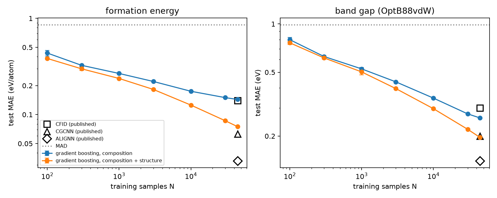
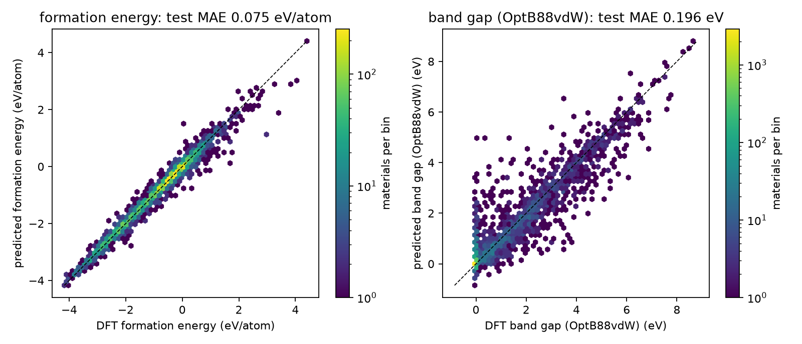
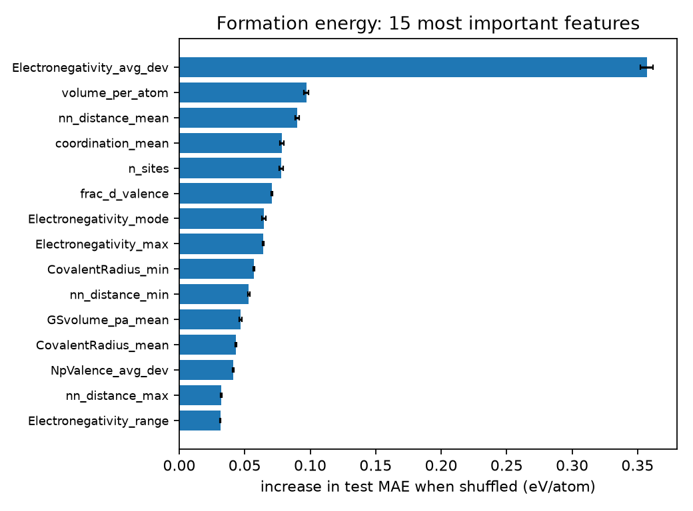

# Baselines

How far do hand-made descriptors and decision-tree ensembles get on DFT formation energies and band gaps? This experiment sets the bar that the graph network of the `cgcnn` experiment, and every later method, has to clear. It uses the JARVIS-DFT 2021.8.18 snapshot, for which published CFID, CGCNN and ALIGNN errors exist, and checks the training pipeline by reproducing the published CFID baseline before trusting its own descriptors. Notebook: [baselines.ipynb](baselines.ipynb) (or download [baselines.html](baselines.html)).

## What is done

| Section | Content |
|---|---|
| 1 | Data: JARVIS-DFT 3D 2021.8.18, one record per material (repeated ids removed) |
| 2 | Calibration of the Magpie element table against pymatgen; missing values coded as −9999 found and removed |
| 3 | Descriptors: 136 composition features (Magpie-style statistics) and 14 structure features; computed density checked against JARVIS |
| 4 | Pipeline check: the published CFID + gradient boosting baseline reproduced with the same code |
| 5 | Mean, ridge regression, random forest and gradient boosting on three random 80/10/10 splits |
| 6 | Learning curves: test error against training-set size |
| 7 | Parity plots |
| 8 | Permutation importance of single features and of the composition and structure blocks |

## Key results

Test MAE, mean ± standard deviation over three random 80/10/10 splits (44 570 / 5571 / 5571 materials):

| Model | Formation energy (eV/atom) | Band gap (eV) | Band gap, materials with a gap (eV) |
|---|---|---|---|
| mean of the training set | 0.858 ± 0.008 | 0.986 ± 0.010 | 1.609 ± 0.034 |
| ridge regression, composition + structure | 0.329 ± 0.003 | 0.678 ± 0.008 | 1.070 ± 0.020 |
| random forest, composition + structure | 0.101 ± 0.002 | 0.226 ± 0.004 | 0.464 ± 0.004 |
| gradient boosting, composition | 0.144 ± 0.004 | 0.251 ± 0.006 | 0.532 ± 0.018 |
| **gradient boosting, composition + structure** | **0.076 ± 0.002** | **0.198 ± 0.002** | **0.419 ± 0.010** |
| *published (their split): CFID / CGCNN / ALIGNN* | *0.14 / 0.063 / 0.033* | *0.30 / 0.20 / 0.14* | — |

- **Pipeline check passed.** The published CFID descriptors with the same training and evaluation code give 0.135 eV/atom and 0.288 eV (paper: 0.14 and 0.30), and the target MADs are 0.861 and 0.993 (paper: 0.86 and 0.99).
- **150 simple features beat 1557 CFID features.** The best baseline has about half the CFID error for the formation energy and is 1.2 times the published CGCNN error; for the band gap it matches CGCNN. These, not the MAD, are the numbers a graph network has to beat.
- **Composition is not enough.** Composition alone gives 0.144 eV/atom and a learning curve that flattens (slope −0.17 above 1000 samples), because polymorphs share a formula; 14 structure features halve the error and keep the curve falling (slope −0.31). Shuffling all structure features raises the test MAE by 0.44 eV/atom, all composition features by 1.02 eV/atom.
- **Ionicity first.** The spread of electronegativity in the compound is by far the most important single feature for the formation energy, in line with Pauling's definition of electronegativity through the extra stability of bonds between unlike atoms.
- **The band gap is two problems.** 67.5 % of the gaps are exactly 0 (metals); for the materials with a gap the error is twice the overall one, and 1573 of 5571 test predictions are negative. Setting them to 0 changes the split-0 MAE from 0.196 to 0.187 eV.
- **Calibration found two problems in the inputs.** The Magpie element table codes missing values as −9999 (now NaN), and five JARVIS ids occur 2 to 6 times (only the first copy is kept). The atomic-mass tables of Magpie and JARVIS differ for a few elements (Zn 65.38 vs 65.409, Mo 95.96 vs 95.94, Yb 173.054 vs 173.04), which moves the density feature by up to 4.4 × 10⁻⁴ relative to the same cell with the JARVIS masses.

## Validation

| Quantity | This run | Check | Check from |
|---|---|---|---|
| MAD of the formation energy | 0.861 eV/atom | 0.86 | Choudhary & DeCost 2021, Table 3 |
| MAD of the band gap | 0.993 eV | 0.99 | Choudhary & DeCost 2021, Table 3 |
| CFID + gradient boosting, formation-energy MAE | 0.135 eV/atom | 0.14 | Choudhary & DeCost 2021, Table 3 |
| CFID + gradient boosting, band-gap MAE | 0.288 eV | 0.30 | Choudhary & DeCost 2021, Table 3 |
| Element data: atomic number, atomic weight, period, group, s/p/d/f valence electrons (89 elements) | 89/89 for each | 89/89 | pymatgen |
| Raw Magpie values coded −9999 | 4, all now NaN | none left | electronegativity of He, Ne, Ar; melting point of He |
| Density from our cell volumes with the JARVIS masses and units, largest difference (55 712 materials) | 5.0 × 10⁻⁴ g/cm³, none above 0.0005 | ≤ 0.0005 | JARVIS density (3 decimals) |
| Composition features of NaCl, Fe₂O₃, Fe | equal | hand calculation | pytest |
| Nearest-neighbor distance and coordination of sc, bcc, fcc, hcp, diamond, rock salt | equal | closed form | pytest |
| Density of fcc Cu | equal | closed form | pytest |

The pytest suites (149 tests for this experiment) also check invariance of the features to scaling and reordering of the formula and to supercells, the handling of missing elemental values, and the split sizes.

## Figures



*Test MAE against the number of training samples for gradient boosting with composition features (blue) and with composition and structure features (orange); mean and spread of three training subsets of split 0. Open symbols: the published CFID, CGCNN and ALIGNN errors at their training-set size (their split); dotted line: MAD. With composition alone the error levels off; with structure it keeps falling.*



*Predicted against DFT values for the test set of split 0 (gradient boosting, composition and structure). Color: number of materials per bin. The column at a DFT band gap of 0 is the two thirds of materials that are metals; a few of them are predicted to have gaps of several eV.*



*Increase in the test MAE of the formation-energy model when one feature is shuffled across the test set (mean and spread of five shuffles). Correlated features share their importance, so only the top of the ranking is meaningful feature by feature.*

## Notes

- **Snapshot.** jarvis-tools also offers newer snapshots (`dft_3d_2022` with about 76 000 and `dft_3d` with about 94 000 materials). The 2021.8.18 snapshot is used because the published CFID, CGCNN and ALIGNN numbers (Choudhary & DeCost, *npj Comput. Mater.* **7**, 185, 2021, Table 3) refer to it.
- **Repeated ids.** The snapshot has 55 723 records but 55 712 distinct JARVIS ids: five ids occur 2 to 6 times. Four have identical copies; the copies of JVASP-97311 (LiBS₂O₈) differ by 2.9 meV/atom in formation energy. Only the first copy is kept, so that no material is in both the training and the test set.
- **Not every record is a crystal.** Eight records (Al, Cl, H, Na, P, S, HS, Si) are an isolated atom or molecule in a large empty box, with densities below 0.01 g/cm³ (the H atom's density rounds to 0.000). They are reference calculations, not crystals, but they are kept so that the dataset is the one the published numbers refer to.
- **Units.** JARVIS converts masses with 1 amu = 1.66054 × 10⁻²⁴ g, this package with the CODATA value 1.66053906660 × 10⁻²⁴ g; the geometry check uses the JARVIS factor so that it tests the cell volumes alone.
- **Element data.** The values are the Magpie table of Ward et al. (*npj Comput. Mater.* **2**, 16028, 2016) shipped with jarvis-tools. It codes missing values as −9999 (electronegativity of He, Ne, Ar; melting point of He); used as numbers they would wreck every statistic of a compound containing those elements, so they become NaN and the tree models treat them as missing. The ground-state space-group number of each element is left out because a label has no meaningful mean. For Po and Rn, which have no stable isotope, Magpie gives the mass number of the longest-lived isotope (209, 222) and pymatgen a different one (210, 220); neither element occurs in the dataset.
- **Gradient boosting.** The CFID baseline of the paper used LightGBM; here scikit-learn's `HistGradientBoostingRegressor`, an implementation of the same histogram-based algorithm, is used for every gradient-boosting model. Early stopping uses the validation set; the test set is never used for any choice.
- **Splits.** All splits are random. A random split puts close relatives of every test material (same elements, same structure type) into the training set, so these errors measure interpolation. How much they grow when whole chemical systems are held out is the question of the `data_splits` experiment.

## Files

| File | Contents |
|---|---|
| [`materials_ml_primer/data.py`](../../materials_ml_primer/data.py) | JARVIS download, de-duplication, structure arrays |
| [`materials_ml_primer/descriptors.py`](../../materials_ml_primer/descriptors.py) | Magpie-style composition features, structure features |
| [`materials_ml_primer/splits.py`](../../materials_ml_primer/splits.py) | random train/validation/test split |
| [`tests/test_descriptors.py`](../../tests/test_descriptors.py), [`tests/test_data.py`](../../tests/test_data.py), [`tests/test_splits.py`](../../tests/test_splits.py) | pytest suites |
| `baselines.ipynb` | executed notebook: every number and figure above |
| `baselines.html` | the same notebook as a web page |
| `figures/` | figures written by the notebook |

## Run

From the repository root, after the setup in [../../README.md](../../README.md):

```bash
conda activate mmp
pytest -q tests/test_descriptors.py tests/test_data.py tests/test_splits.py
cd experiments/baselines
jupyter lab baselines.ipynb    # Run All downloads the data (about 0.5 GB) on first use
```

Everything runs on the CPU; no GPU is needed.
