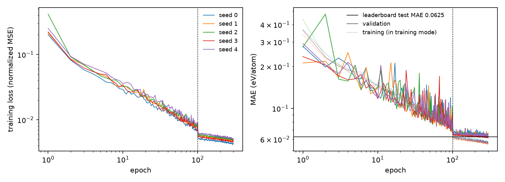
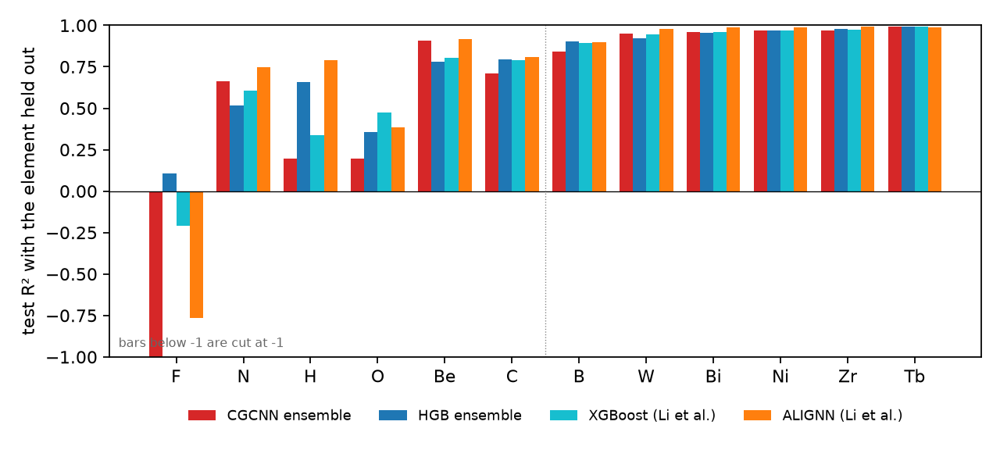
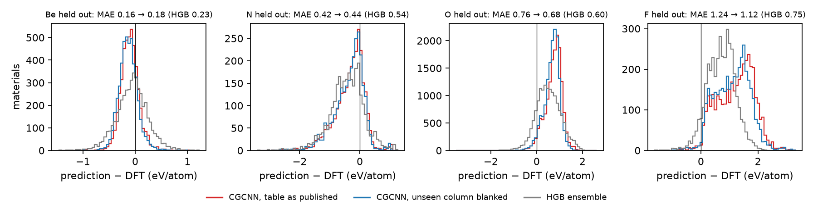
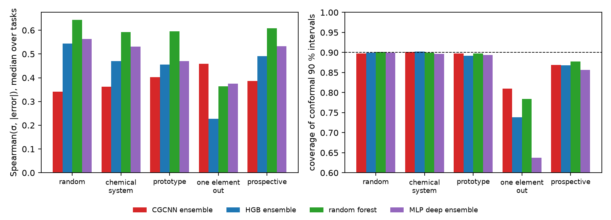

# CGCNN

Does a network that reads the crystal structure itself do better than gradient boosting on descriptors where it matters, on materials unlike the training set? The crystal graph convolutional neural network (CGCNN; Xie & Grossman, Phys. Rev. Lett. 120, 145301, 2018) is re-implemented from the authors' released code, shown to compute exactly what that code computes, and shown to reproduce its published accuracy on the JARVIS leaderboard. Ensembles of five CGCNNs are then trained on the 43 test sets of the `uncertainty` experiment that this run covers, with the same training, validation, calibration and test materials, so that every comparison with gradient boosting, the random forest and the deep ensemble of that experiment is paired. Notebook: [cgcnn.ipynb](cgcnn.ipynb) (or [as a web page](https://shuruyue.github.io/Materials-ML-Primer/experiments/cgcnn/cgcnn.html)).

## What is done

| Section | Content |
|---|---|
| 1 | Data: the JARVIS-DFT 2021.8.18 snapshot and the materials added up to 2025.9.24, as graphs of the 12 nearest neighbors within 8 Å |
| 2 | Verification: the authors' code with the same weights; the neighbor lists of the authors' construction; the CIF path of the leaderboard run |
| 3 | Validation: five networks on the JARVIS leaderboard split against the leaderboard's CGCNN entry; how many epochs are needed |
| 4 | Distribution shift: CGCNN ensembles against the models of the `uncertainty` experiment on random, chemical-system and prototype cross-validation, 12 held-out elements and the prospective test; feature columns that training never sees |
| 5 | Uncertainty: the spread of the five networks as an uncertainty (ranking, conformal intervals, calibration) |
| 6 | Summary table and export of the results |

## Key results

**Formation-energy MAE** (eV/atom, mean over the test sets of a split; the same training, validation and test materials for every model):

| Test set | CGCNN, one network | CGCNN, ensemble of 5 | HGB ensemble | random forest | MLP deep ensemble | MAE / random split: CGCNN ensemble, HGB |
|---|---|---|---|---|---|---|
| random 10-fold cross-validation | 0.066 | 0.056 | 0.088 | 0.106 | 0.105 | 1.00, 1.00 |
| chemical-system groups | 0.072 | 0.062 | 0.105 | 0.131 | 0.121 | 1.10, 1.20 |
| prototype groups | 0.095 | 0.084 | 0.157 | 0.182 | 0.191 | 1.49, 1.79 |
| leave one element out (12 elements) | 0.408 | 0.382 | 0.303 | 0.333 | 0.368 | 6.80, 3.45 |
| prospective (materials added after 2021) | 0.083 | 0.073 | 0.117 | 0.140 | 0.132 | 1.30, 1.33 |

**Leave one element out, element by element** (left: the six elements that gradient boosting predicted worst in `data_splits`; Li et al. 2024 used JARVIS 2022.12.12 with their own splits and settings, so their R² is context, not a check):

| Element held out | Compounds | MAE CGCNN | MAE HGB | R² CGCNN | R² HGB | R² XGBoost (Li et al.) | R² ALIGNN (Li et al.) | Unseen column: CGCNN MAE with it blanked |
|---|---|---|---|---|---|---|---|---|
| F | 3911 | 1.238 | 0.747 | −1.303 | 0.106 | −0.207 | −0.764 | 1.120 |
| N | 2789 | 0.424 | 0.544 | 0.662 | 0.515 | 0.606 | 0.749 | 0.438 |
| H | 2769 | 0.601 | 0.393 | 0.194 | 0.657 | 0.339 | 0.788 | none |
| O | 14992 | 0.756 | 0.601 | 0.196 | 0.358 | 0.474 | 0.383 | 0.681 |
| Be | 4548 | 0.158 | 0.232 | 0.906 | 0.780 | 0.806 | 0.916 | 0.178 |
| C | 2812 | 0.392 | 0.276 | 0.709 | 0.795 | 0.789 | 0.807 | none |
| B | 1956 | 0.354 | 0.253 | 0.842 | 0.902 | 0.892 | 0.900 | none |
| W | 1326 | 0.181 | 0.177 | 0.948 | 0.923 | 0.944 | 0.980 | none |
| Bi | 1787 | 0.150 | 0.133 | 0.960 | 0.956 | 0.962 | 0.987 | none |
| Ni | 2697 | 0.106 | 0.098 | 0.971 | 0.968 | 0.968 | 0.988 | none |
| Zr | 1438 | 0.155 | 0.135 | 0.968 | 0.976 | 0.976 | 0.991 | none |
| Tb | 843 | 0.071 | 0.051 | 0.992 | 0.991 | 0.993 | 0.988 | none |

**The spread of the five networks as an uncertainty**, with the measures of the `uncertainty` experiment:

| Test set | Spearman(uncertainty, error), median over test sets: CGCNN / HGB / RF / MLP | Coverage of 90 % conformal intervals scaled by the uncertainty: CGCNN / HGB / RF / MLP | Coverage, constant width: CGCNN / HGB | CGCNN inside the 90 % Gaussian interval, as stated → scaled (factor) |
|---|---|---|---|---|
| random 10-fold cross-validation | 0.34 / 0.54 / 0.64 / 0.56 | 0.897 / 0.899 / 0.901 / 0.899 | 0.902 / 0.899 | 68 % → 92 % (2.34) |
| chemical-system groups | 0.36 / 0.47 / 0.59 / 0.53 | 0.902 / 0.902 / 0.899 / 0.897 | 0.902 / 0.899 | 68 % → 93 % (2.34) |
| prototype groups | 0.40 / 0.46 / 0.60 / 0.47 | 0.898 / 0.892 / 0.898 / 0.894 | 0.895 / 0.887 | 63 % → 92 % (2.52) |
| leave one element out (12 elements) | 0.46 / 0.23 / 0.36 / 0.37 | 0.810 / 0.738 / 0.784 / 0.637 | 0.377 / 0.600 | 51 % → 86 % (2.41) |
| prospective (materials added after 2021) | 0.39 / 0.49 / 0.61 / 0.53 | 0.869 / 0.868 / 0.878 / 0.856 | 0.857 / 0.870 | 63 % → 93 % (2.72) |

- **Where the elements are known, CGCNN is better and loses less under shift.** The ensemble beats gradient boosting on all 10 folds of each cross-validation and on the prospective test, with 36–47 % lower MAE, and even one network has a lower mean MAE than the gradient-boosting ensemble. On new structure types its MAE grows 1.49-fold over the random split, against 1.79-fold for gradient boosting.
- **Unseen elements are the exception.** With an element held out, CGCNN is worse than gradient boosting on 10 of 12 elements, and its error grows 6.8-fold (gradient boosting 3.45-fold). The order of the elements by R² is that of ALIGNN in Li et al. (Spearman 0.96): the same elements are hard for every model, and the graph network fails harder on them. Fluorides are overestimated by 1.23 eV/atom on average.
- **Untrained input weights explain little of it.** Four elements have a one-hot atom-feature column that no training material has, so its weights stay random (ALIGNN's default atom features are the same table). Setting that column to zero leaves the training unchanged and lowers the error on F and O by about a tenth (1.24 → 1.12 and 0.76 → 0.68 eV/atom), not to the level of gradient boosting, and raises it slightly on Be and N. This test was designed after the first results were seen.
- **The spread of the five networks ranks errors poorly in distribution and best under the hardest shift.** On the random, chemical-system, prototype and prospective splits it ranks the errors worse than every uncertainty of the descriptor models and is 2.3–2.7 times too small; with an element held out it ranks best within an element's compounds and its scaled conformal intervals keep the most coverage (0.81). Constant-width intervals do the opposite (0.38): CGCNN's small calibration residuals make them narrow.
- **Confidently wrong, no longer.** On the structure type that every descriptor model predicted badly in the `uncertainty` experiment (1402 ABC₄ compounds of space group F-43m), CGCNN halves the error (0.32 against 0.65 eV/atom) and puts its uncertainty at the 89th percentile, where the deep ensemble put it at the 22nd.

## Validation

| Quantity | This run | Check | Check from |
|---|---|---|---|
| Outputs of 300 crystals with the same weights as the authors' code | largest difference 2.4 × 10⁻⁷ (training mode) and 1.2 × 10⁻⁶ (evaluation mode), outputs up to 1.9 | equal up to float32 rounding | txie-93/cgcnn, commit f42ab23 |
| Neighbor lists and distances of 2000 JARVIS structures | identical in 2000 of 2000 | identical | the original's construction (`Structure.get_all_neighbors`, sorted by distance) |
| CIF path of the leaderboard run, 300 structures | atoms move at most 6.3 × 10⁻⁴ Å, neighbor distances change at most 6.0 × 10⁻⁴ Å; atoms reordered in 48 | only the rounding of CIF coordinates | jarvis-tools CIF writer and the original `CIFData` |
| Test MAE on the leaderboard split, one network | 0.0641 ± 0.0012 eV/atom (5 seeds, 0.0627–0.0656) | 0.0625 | JARVIS leaderboard, CGCNN entry (Choudhary et al. 2024) |
| The same | | 0.063 | Choudhary & DeCost 2021, Table 3 |
| Correlation of the test errors with those of the leaderboard's network | 0.749 (seed 0); between two of our seeds 0.743 | | |
| Test MAE on the leaderboard split, ensemble of 5 | 0.0548 eV/atom | | |
| Leave one element out: R² of the 12 elements | Spearman 0.96 with ALIGNN, 0.95 with gradient boosting | ALIGNN R² per element on JARVIS | Li et al. 2024, Suppl. Fig. 3 (context: other snapshot, splits and settings) |
| 150-epoch shift networks against the first 150 epochs of a 300-epoch network with the same seed | identical test MAE on 3 of 3 tasks (0.0744, 0.0771, 1.5042) | identical up to the order of GPU additions | the training procedure |
| Validation MAE of the networks with a blanked column against the originals | equal within 2 × 10⁻⁸ eV/atom on all 20 | equal (the blanked column is absent from training) | the training procedure |

The pytest suite run by the notebook (10 tests) checks the neighbor lists against the lines of the original that build them (CsCl, where the 8 + 6 nearest neighbors are cut at 12, rock salt and two random cells), the padding of an isolated atom, batching, one convolution against the formula written out atom by atom in float64, the invariance of a prediction to the order of the atoms, a rotation and a supercell, and training that overfits one batch.

## Figures



*Training loss and MAE of the five networks on the leaderboard split (log-log). The learning rate drops tenfold at epoch 100 (dashed). The validation MAE ends just above the leaderboard's test MAE; the training MAE is computed in training mode, with batch statistics in the batch-norm layers.*



*Test R² with all compounds of one element held out, for the CGCNN and gradient-boosting ensembles of this repository and for XGBoost and ALIGNN of Li et al. 2024 (JARVIS 2022.12.12, their own splits and settings). Left of the dotted line: the six elements that gradient boosting predicted worst in `data_splits`; right: six spread over the others.*



*Signed error (prediction − DFT) for the compounds of the four held-out elements whose atom features contain a column that no training material has: the CGCNN ensemble with the table as published (red) and with that column set to zero (blue), and the gradient-boosting ensemble (gray). Blanking moves the fluorides and oxides slightly towards zero; most of the overestimation remains.*



*Left: Spearman correlation between the uncertainty and the absolute error, median over the test sets of a split. Right: coverage of conformal 90 % intervals scaled by each uncertainty (dashed: the target).*

## Protocol

- **Data.** The formation energy per atom of the JARVIS-DFT 2021.8.18 snapshot (55 712 materials after the deduplication of `baselines`) and of the 38 190 materials added up to 2025.9.24. Each structure becomes a graph as in the original code: the 12 nearest neighbors of every atom within 8 Å (pymatgen's neighbor search, ties in the order the original sorts them), padded with index 0 at 9 Å where fewer are found (161 structures, 3528 of 6.7 million entries); edges are expanded in 41 Gaussians with centers 0–8 Å and width 0.2 Å, atoms are the 92 one-hot features of the original `atom_init.json` (vendored, MIT license).
- **Network and training**, as in the released code (commit f42ab23) with its default settings: an embedding of 64 features, three convolutions, mean pooling, one hidden layer of 128 softplus units; SGD with learning rate 0.01 and momentum 0.9, batches of 256 crystals, mean squared error on standardized targets, the learning rate divided by 10 at epoch 100, and the weights of the epoch with the lowest validation MAE kept.
- **Leaderboard.** The formation-energy split of the JARVIS leaderboard (pinned commit 4f1356e; 44 569 training, 5 572 validation and 5 572 test materials of `dft_3d_2021`), five networks with seeds 0–4, 300 epochs as in the leaderboard's run script, compared with the leaderboard's CGCNN predictions material by material.
- **Distribution shift.** The test sets of the `uncertainty` experiment with all their parts: 10 folds each of random, chemical-system and prototype cross-validation (70/10/10/10), the prospective test (trained on 2021, tested on the materials added later) and leave one element out for 12 of its 78 elements: the six with the lowest R² of gradient boosting in `data_splits` (F, N, H, O, Be, C) and the middle element of six equal parts of the other 72 ordered by that R² (B, W, Bi, Ni, Zr, Tb). Five networks (seeds 0–4) per test set, 150 epochs. The descriptor models are the cached predictions of the `uncertainty` experiment: the bootstrap ensemble of five gradient-boosting models (HGB), the random forest and the deep ensemble of five multilayer perceptrons (MLP), on 150 composition and structure features.
- **Uncertainty.** The standard deviation of the five networks, evaluated with the measures of the `uncertainty` experiment: Spearman correlation with the absolute error, split conformal 90 % intervals from the calibration set (constant width and scaled by the standard deviation), and the share inside the central 90 % Gaussian interval as stated and after std scaling.

## Differences from standard practice

The 243 networks (5 on the leaderboard split, 215 on the shift test sets, 3 checks of the training length and 20 for the feature-column test) took 48 hours of process time, run as three processes at a time on one RTX 3060 (about 16 hours of wall-clock time). These choices keep it there; each is a simplification of what a full study would do.

- **150 epochs instead of 300 for the shift networks.** The leaderboard run and the original's example train for 300 epochs. On the leaderboard split, stopping at 150 epochs raised the validation MAE of the five networks by 2.6 % and halved the time, and the networks of sections 4 and 5 were trained for 150. They were still improving: 56 % of them reached their best validation MAE in the last 10 epochs. One 300-epoch network on each of three shift tasks was 1.7 % (first chemical-system fold) and 6.5 % (first prototype fold) better, and 0.6 % worse with F held out. CGCNN's numbers under shift are therefore slightly pessimistic.
- **Targets standardized with training materials only.** The original computes the mean and standard deviation of the targets from 500 random materials of the whole data set, test set included; here the 500 are drawn from the training set. This is one candidate for the 2.5 % between our networks and the leaderboard's.
- **Two leaderboard materials removed from training.** JVASP-113961 and JVASP-116461, whose records are repeated in `dft_3d_2021`, are in both the training and the test set of the leaderboard split; they stay in the test set.
- **Structures taken directly, not through CIF files.** The leaderboard run writes and reads CIF files; the verification shows that this changes the graphs only by the rounding of the coordinates (below 10⁻³ Å).
- **An ensemble of seeds, not of bootstrap resamples.** The five networks differ only in their initial weights and the order of the batches; the gradient-boosting ensemble they are compared with is trained on bootstrap resamples. Neither predicts a variance.
- **No hyperparameter search.** The network and training use the original's defaults, which were not tuned for this data or for shifted test sets; the descriptor models keep the settings and simplifications of the `uncertainty` experiment (for gradient boosting: learning rate 0.1, at most 2500 iterations).
- **12 of 78 elements held out.** The six hardest for gradient boosting and six spread over the rest, to keep the run in hours; means over these 12 elements are not comparable with the 78-element means of the `uncertainty` experiment.
- **A test added after the results.** The feature-column test was designed after the poor result for F had been seen. Its elements are fixed by a rule (every held-out element with a column that no training material has), not chosen by result.
- **One assignment of materials per task.** The only replication is over the five seeds; the spread given is between folds or elements.
- **Not bit-for-bit reproducible.** The GPU adds the messages of the convolution in an unspecified order, so a rerun gives slightly different numbers (in the checks above, equal to four decimals).
- **Training times are upper bounds.** Three processes shared one GPU, so the time stored with each network is longer than the network would take alone (about 11.5 minutes for 300 epochs on the leaderboard split).

## Files

| File | Contents |
|---|---|
| [`materials_ml_primer/cgcnn.py`](../../materials_ml_primer/cgcnn.py) | the graph construction, the network (with the attribute names of the original, so that its state dict loads into the original), the featurizer and the training loop |
| [`materials_ml_primer/cgcnn_atom_init.json`](../../materials_ml_primer/cgcnn_atom_init.json) | the original's 92 atom features (MIT license, see [THIRD_PARTY_NOTICES.md](../../THIRD_PARTY_NOTICES.md)) |
| [`tests/test_cgcnn.py`](../../tests/test_cgcnn.py) | pytest suite: neighbor lists against the original construction, padding, batching, one convolution against the formula written out atom by atom, invariance to atom order, rotation and supercell, overfitting one batch |
| [`runs.py`](runs.py) | the test sets and the training of every network, cached in `data/cgcnn_cache` so that a run can be split and resumed |
| [`_build/build_cgcnn.py`](../../_build/build_cgcnn.py) | writes the notebook |
| `cgcnn.ipynb` | executed notebook: every number and figure above |
| `cgcnn.html` | the same notebook as a web page |
| `cgcnn_results.json` | the numbers of the tables, written by the notebook |
| `figures/` | figures written by the notebook |

## Run

From the repository root, after the setup in [../../README.md](../../README.md), and after the `uncertainty` experiment has filled its cache (its predictions are the comparison):

```bash
conda activate mmp
pytest -q tests/test_cgcnn.py
cd experiments/cgcnn
python runs.py leaderboard 0 1          # 5 networks, about 1 h on an RTX 3060
python runs.py budget,shift 0 3         # 218 networks; run with 1 3 and 2 3 in two more terminals (about 14 h)
python runs.py blanked 0 3              # 20 networks; also with 1 3 and 2 3 (about 1.3 h)
jupyter lab cgcnn.ipynb
```

Three processes at a time use the GPU about 1.6 times better than one, because a single network is limited by memory bandwidth, not arithmetic. The notebook trains whatever is not cached, so it can also be run directly, but then one network after the other. `python ../../_build/build_cgcnn.py test.ipynb --quick` writes a version that uses only the cached networks and trains nothing.
