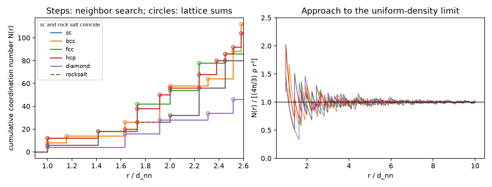
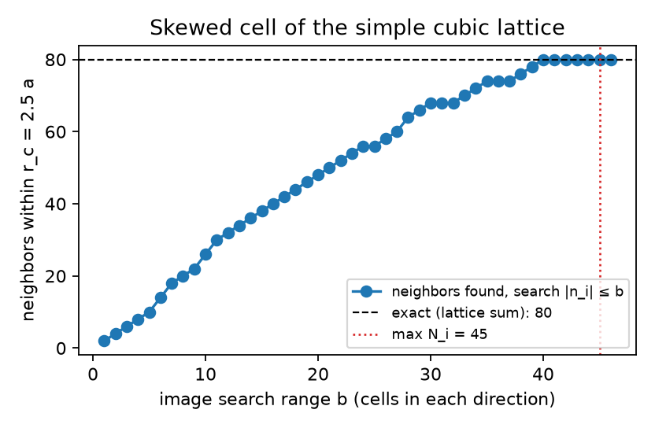
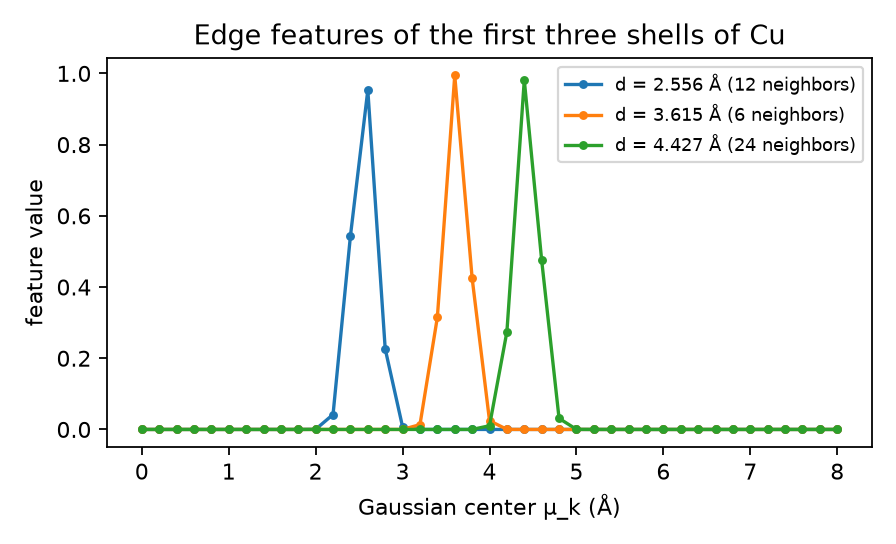

# Crystal graphs

A crystal is periodic, so "the neighbors of an atom" includes atoms in neighboring unit cells. This experiment builds the graph that every crystal graph network starts from: one node per atom of the cell and one directed edge j → i for every periodic image of atom j within the cutoff radius r_c of atom i, labeled by its length. The neighbor search is written from scratch and checked against results that do not share its code. Notebook: [crystal_graphs.ipynb](crystal_graphs.ipynb) (or download [crystal_graphs.html](crystal_graphs.html)).

## What is done

| Section | Content |
|---|---|
| 1 | How many periodic images to search: the bound \|n_i\| ≤ ⌈r_c / d_i⌉ from the lattice-plane spacings d_i, shown on a strongly skewed cell |
| 2 | Coordination shells of sc, bcc, fcc, ideal hcp, diamond and rock salt against exact lattice sums |
| 3 | Edge-for-edge comparison with pymatgen's neighbor search |
| 4 | Invariance under rotation, translation, atom permutation and supercells |
| 5 | Gaussian distance features as used by CGCNN |
| 6 | What capping the number of neighbors (CGCNN keeps 12) does when neighbors are tied |

## Key results

- **Shells**: in the primitive cells, the first 8 coordination shells of all six structures have the exact counts and radii of the lattice sums (largest relative radius error 4.4×10⁻¹⁶). fcc: 12, 6, 24, 12, 24, 8, 48, 6; ideal hcp: 12, 6, 2, 18, 12, 6, 12, 12, the same as fcc for two shells and different from the third on.
- **Image bound**: the simple cubic lattice written with the skewed cell rows (1,0,0), (5,1,0), (3,4,1) has plane spacings 0.0563, 0.2425 and 1 (in units of a), so r_c = 2.5 a needs images up to (45, 11, 3). Searching only the ±1 neighboring cells finds 2 of the 80 neighbors; a uniform search range needs 40 cells in every direction to find all 80.
- **pymatgen**: 19 770 edges in 8 structures (4 real, 4 random triclinic with coordinates outside the cell), r_c = 8 Å: identical edge sets, largest relative difference of edge lengths 1.8×10⁻¹⁵.
- **Neighbor cap**: in bcc Fe, the 12 nearest neighbors are 8 first neighbors and 4 of the 6 equidistant second neighbors. Six random rotations of the same crystal gave 4 different choices of those 4; the kept distances are always 8 × d₁ + 4 × d₂.

## Validation

| Quantity | This run | Check | Check from |
|---|---|---|---|
| Shell counts, first 8 shells, 6 structures | all equal | — | exact lattice sums (integer vectors counted by squared length) |
| Shell radii, largest relative error | 4.4×10⁻¹⁶ | 0 | exact lattice sums |
| Skewed sc cell, neighbors within 2.5 a | 80 | 80 | lattice sum |
| Same cell, searching only \|n_i\| ≤ 1 | 2 | 80 | lattice sum (shows what the bound is for) |
| Edges identical to pymatgen (8 structures, 19 770 edges) | yes | yes | pymatgen `get_neighbor_list` |
| Edge lengths vs. pymatgen, largest relative difference | 1.8×10⁻¹⁵ | 0 | pymatgen |
| Rigid rotation (wurtzite ZnO): same edges, length change | yes, 6.7×10⁻¹⁶ | yes, 0 | invariance |
| Translation, length change | 2.2×10⁻¹⁶ | 0 | invariance |
| Atom permutation: edges identical after relabeling | yes | yes | invariance |
| 2×2×1 supercell: each atom has its parent's distances | 4.4×10⁻¹⁶ | 0 | invariance |
| Gaussian feature at d = μ ± σ | 0.367879441171442 | e⁻¹ | exact |

The pytest suite (55 tests) also checks the plane spacings against V/|a_j × a_k|, that one more layer of images never adds an edge, the symmetry (i, j, n) ↔ (j, i, −n) of the uncapped graph, and the lattice sums themselves against standard tables.

## Figures



*Left: cumulative coordination number N(r) from the neighbor search (steps) and from the lattice sums (circles); sc and rock salt coincide in units of the nearest-neighbor distance. Right: N(r) divided by the number of atoms in a sphere of uniform density, (4π/3) ρ r³, which tends to 1 at large r for every structure.*



*The simple cubic lattice described by a skewed cell: neighbors found within 2.5 a when every image with |n_i| ≤ b is searched. The count reaches the exact 80 only at b = 40; the bound from the plane spacings, (45, 11, 3), is always sufficient.*



*CGCNN edge features of the first three shells of fcc Cu: each distance switches on the Gaussians centered near it (centers every 0.2 Å, width 0.2 Å).*

## Notes

- The NumPy search visits every atom pair in every image cell. It is written for clarity and verification; for the tens of thousands of structures in the `cgcnn` experiment, pymatgen's compiled search is used, which this experiment shows gives identical edges.
- Comparisons of edge lists are made as sets: crystals have many exactly equal distances, and round-off can change their order.

## Files

| File | Contents |
|---|---|
| [`materials_ml_primer/graphs.py`](../../materials_ml_primer/graphs.py) | neighbor search, coordination shells, graph assembly, Gaussian features, exact lattice sums |
| [`tests/test_graphs.py`](../../tests/test_graphs.py) | pytest suite (55 tests) |
| `crystal_graphs.ipynb` | executed notebook: every number and figure above |
| `crystal_graphs.html` | the same notebook as a web page |
| `figures/` | figures written by the notebook |

## Run

From the repository root, after the setup in [../../README.md](../../README.md):

```bash
conda activate mmp
pytest -q tests/test_graphs.py
cd experiments/crystal_graphs
jupyter lab crystal_graphs.ipynb    # Run All reproduces every number and figure
```
