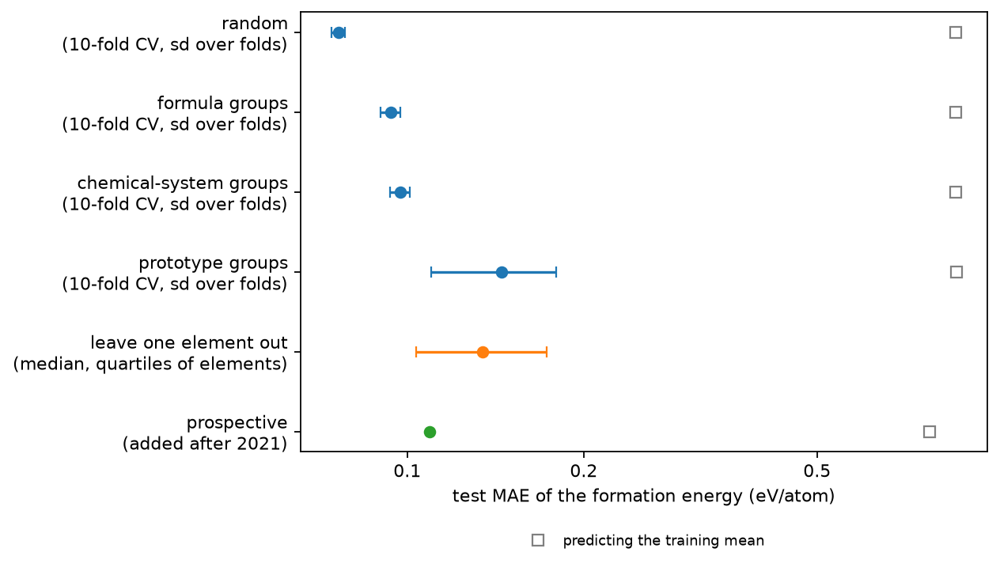
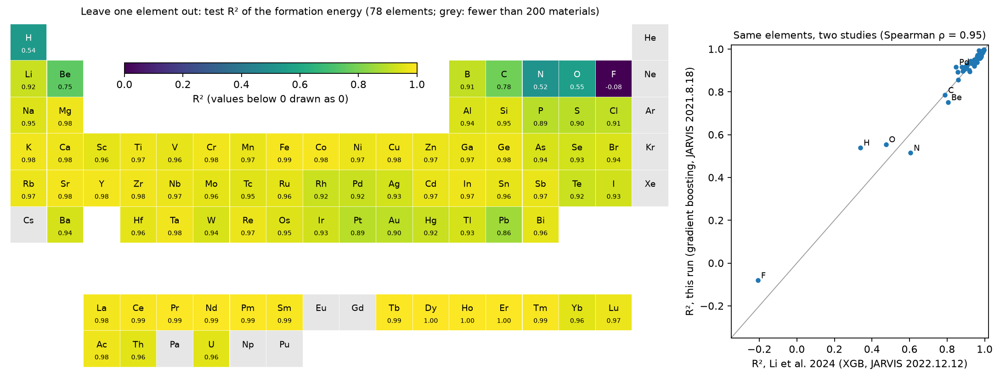
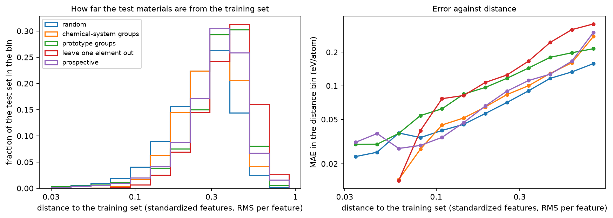

# Data splits

How much does a random train/test split flatter a materials model? The `baselines` experiment reached 0.076 eV/atom for the formation energy on random splits of JARVIS-DFT, but a random split puts close relatives of most test materials into the training set: another polymorph of the same formula, another compound of the same elements, another material of the same structure type. This experiment takes those relatives out of the training set step by step, holds out whole elements, and finally tests on materials that JARVIS computed after the training data was frozen. For every test material it also measures the distance to the training set, the first step towards a model that knows when it is unreliable. Notebook: [data_splits.ipynb](data_splits.ipynb) (or [as a web page](https://shuruyue.github.io/Materials-ML-Primer/experiments/data_splits/data_splits.html)); **[interactive page](https://shuruyue.github.io/Materials-ML-Primer/web/data_splits.html)** with the periodic table, the parity plots and the distance analysis.

## What is done

| Section | Content |
|---|---|
| 1 | Data: the JARVIS-DFT 2021.8.18 snapshot for training, and the 38 190 materials added up to 2025.9.24 |
| 2 | Group labels: reduced formula, chemical system and a structure-prototype label (space group and Wyckoff positions, independent of the choice of origin and axes) |
| 3 | How closely related the test sets are to the training sets under each split |
| 4 | 10-fold cross-validation with random, formula, chemical-system and prototype groups |
| 5 | Leave one element out for 78 elements, compared element by element with Li et al. (2024) |
| 6 | Prospective test: trained on 2021, tested on the materials added later |
| 7 | Test error against the distance to the training set |

## Key results

Test MAE of the formation energy with the same model and features; the cross-validation errors are over all 55 712 materials, with the standard deviation over the ten folds:

| Test set | Test MAE (eV/atom) | R² | × random | Iterations (mean) |
|---|---|---|---|---|
| random 10-fold cross-validation | 0.076 ± 0.002 | 0.983 | 1.00 | 5000 |
| formula groups (polymorphs held out together) | 0.094 ± 0.004 | 0.977 | 1.23 | 4778 |
| chemical-system groups (same elements held out together) | 0.097 ± 0.004 | 0.976 | 1.27 | 4857 |
| prototype groups (same structure type held out together) | 0.145 ± 0.035 | 0.947 | 1.90 | 3640 |
| leave one element out (78 elements; median over elements) | 0.134 | R² > 0.95 for 62 % of the elements | 1.76 | — |
| prospective: trained on 2021, tested on the 38 190 materials added up to 2025 | 0.109 | 0.960 | 1.43 | 5000 |
| *predicting the training mean (random / prospective)* | *0.861 / 0.778* | — | — | — |

- **A random split tests on close relatives.** In random cross-validation 39 % of the test materials have a polymorph in the training set, 72 % a compound of exactly the same elements and 92 % a material of the same structure prototype.
- **Each kind of relative held out costs accuracy.** Holding out polymorphs together raises the error by 23 %, whole chemical systems by 27 % and whole structure prototypes by 90 %, with a fold-to-fold spread nine times that of the chemical-system folds. R² hides most of this (0.983 against 0.947) because the formation energies themselves vary far more (mean absolute deviation 0.86 eV/atom) than the errors.
- **A chemical-system split is not new chemistry.** With whole chemical systems held out, 75 % of the test materials still have one of their subsystems in the training set (a binary of a test ternary, for example) and 53 % a larger system that contains theirs; only 1.3 % have no related system at all. That is why it costs little more than the formula split.
- **Unseen elements: the hard ones are the same in two studies.** Holding out all compounds of one element gives R² > 0.95 for 62 % of the 78 elements (Li et al. 2024: 63 % of the same elements), but F (R² −0.08), N, H, O, Be and C are far worse. They are the six worst elements of Li et al. too, with another model, other descriptors and a newer snapshot, and the per-element R² of the two studies have a Spearman correlation of 0.95: the difficulty lies mainly in the element and the data, not in the particular model. Part of that 0.95 is shared by construction, because R² divides an element's error by the spread of its compounds' formation energies and both studies take those from JARVIS; our per-element MAE, which has no such denominator, correlates less with their R² (Spearman −0.77; with our own R², −0.87).
- **The next batch of a database is between the group splits.** On the materials added after 2021 the error (0.109 eV/atom) is higher than under chemical-system groups and lower than under prototype groups. It depends on the kind of material: 0.091 for 3D bulk materials, 0.118 for the intercalated-ion structures (37 % of the added set), 0.16 to 0.21 for low-dimensional ones; materials with an experimental structure (an ICSD id; 5.6 % of the added set against 33.5 % of the 2021 snapshot) are predicted with 0.075 eV/atom, the others with 0.111. A polymorph in the training set lowers the error from 0.121 to 0.068, a prototype in the training set makes no difference (0.109 either way), and the 1.5 % of materials with no related chemical system have an error of 0.419.
- **Distance to the training set flags risky regions, not risky materials.** The error rises with the distance in every test set, and the harder test sets lie further away (median distance 0.27 for random, 0.39 for leave one element out). But per material the link is weak: Spearman correlations of 0.23 to 0.31, and only 15 to 24 % of the 10 % largest errors are among the 10 % most distant materials (10 % by chance). At the same distance (0.2 to 0.4) the error is 0.080 eV/atom for the random test set, 0.092 for chemical-system groups and 0.103 for the prospective set, but 0.134 for prototype groups and 0.153 for leave one element out: the distance accounts for part of what makes a test set hard, and much less of it for new structure types and new elements.
- **The validation set does not decide the result.** With a random instead of a grouped validation set for early stopping, the chemical-system test error changes from 0.100 to 0.098 eV/atom (first three folds).

## Validation

| Quantity | This run | Check | Check from |
|---|---|---|---|
| 2021 materials in the 2025 snapshot with identical structure and formation energy | 55 712 / 55 712 (largest change 0.0000 eV/atom) | all | JARVIS 2021.8.18 against 2025.9.24 |
| Space group from spglib (0.1 Å) equal to the JARVIS space group | 98.4 % | most | JARVIS 2021.8.18 |
| Prototype label unchanged under a random origin, atom order, rotation and inversion (500 JARVIS structures) | 500/500 (321/500 without the normalizer step) | 500/500 | invariance |
| Random 10-fold cross-validation, test MAE | 0.076 eV/atom | 0.076 ± 0.002 | baselines experiment (three random 80/10/10 splits) |
| Leave one element out: Spearman correlation of the per-element R² | 0.95 (78 elements) | high | Li et al. 2024, XGBoost on JARVIS 2022.12.12 |
| Leave one element out: Spearman correlation of our MAE per element with their R² | −0.77 (78 elements) | negative | Li et al. 2024, XGBoost on JARVIS 2022.12.12 |
| Leave one element out: elements with R² > 0.95 | 62 % | 63 % | Li et al. 2024, same elements |
| Leave one element out: the six elements with the lowest R² | F N H O Be C | F H O N C Be | Li et al. 2024 |
| Prototype labels of NaCl, zincblende, diamond, fcc, bcc, CsCl, perovskite, L1₂, ReO₃, Heusler, wurtzite | equal | International Tables, Vol. A | pytest |
| Distance to the training set | equal | brute-force computation | pytest |
| Size balance of the group folds | at least as even | scikit-learn `GroupKFold` | pytest |

The pytest suites run by the notebook (67 tests for the splits, 5 for the data loading) also check that 21 structures of known prototypes get equal labels within a structure type and different labels across types, that the labels are invariant to origin, atom order, rotation, inversion, supercells and the names of the species, that the Wyckoff-set table consists of groups of permutations, and that folds and splits keep groups together.

## Figures



*Test MAE of the formation energy under every split (log scale). Cross-validation: standard deviation over the ten folds; leave one element out: median and quartiles over the 78 elements; squares: predicting the mean of the training set.*



*Left: test R² when all compounds of an element are held out (grey: fewer than 200 materials, not tested). Right: the same R² against those of Li et al. (2024) for XGBoost on a newer JARVIS snapshot; the diagonal marks equal values.*



*Left: distance of the test materials to their five nearest training materials, as a fraction of each test set. Right: MAE in each distance bin (bins with at least 30 materials). The error rises with the distance in every test set, but at the same distance the prototype and leave-one-element-out test sets have larger errors than the random one.*

## Protocol

- **Model.** Gradient boosting (`HistGradientBoostingRegressor`) on 136 composition and 14 structure features with the hyperparameters of the `baselines` experiment; early stopping on a validation set; target: formation energy per atom.
- **Group splits.** 10-fold cross-validation. In a group split every group lies in one fold; the groups are taken from the largest to the smallest and each is put into the fold with the fewest materials so far (as scikit-learn's `GroupKFold` does), so all folds hold 5571 or 5572 materials. Fold *k* is the test set, fold *k* + 1 the validation set and the other eight folds the training set (80/10/10, as in the baselines); the validation set is therefore grouped like the test set, and every material is predicted once. A single test set drawn from whole groups would have depended heavily on whether it happened to contain one of the large groups: the largest prototype, the full-Heusler type, holds 4084 of the 93 902 materials of both snapshots.
- **Leave one element out.** For each of the 78 elements that occur in at least 200 materials, all materials containing it are the test set; the rest is split by chemical system into training (90 %) and validation (10 %) sets.
- **Prospective.** The 2021.8.18 snapshot is split by chemical system into training (90 %) and validation (10 %) sets; the test set is every material of the 2025.9.24 snapshot that is not in the 2021 one. Both snapshots were checked to agree on all 55 712 shared materials (structure and formation energy).
- **Prototype label.** Space group (spglib, tolerance 0.1 Å) and, for each species, its count in the reduced formula and its Wyckoff letters, with the species themselves left out. Equivalent descriptions of the same crystal (different origin or axes) give different Wyckoff letters, e.g. four for zincblende; the label is the smallest of all descriptions related by the normalizer of the space group, using the Wyckoff-set table of PyXtal (see [THIRD_PARTY_NOTICES.md](../../THIRD_PARTY_NOTICES.md)).
- **Distance to the training set.** Mean Euclidean distance to the five nearest training materials in the 150 features, standardized with the training mean and standard deviation (missing values replaced by the training median), divided by √150.

## Differences from standard practice

These choices keep the whole notebook within about an hour and a half on one desktop CPU. Each is a simplification of what a full study would do, and the numbers above should be read with them in mind.

- **No hyperparameter search per split.** The model keeps the hyperparameters chosen for the random split of the baselines; a model tuned for out-of-distribution data might do better on the harder splits. Li et al. (2024) made the same choice for their 700 tasks.
- **The iteration limit is reached.** With a learning rate of 0.05, early stopping does not trigger within 5000 iterations on the random split (as in the baselines), so that model could improve slightly with more iterations; the number of iterations of every split is printed in the notebook.
- **One cross-validation pass, single runs.** The group splits are one 10-fold cross-validation with one fold assignment; the spread given is between folds, not between repeated assignments. Leave one element out and the prospective test are single runs without a spread.
- **A strict prototype label.** The label requires the same space group and Wyckoff positions, at a tolerance of 0.1 Å. A slightly distorted variant of a structure type (a tetragonal perovskite next to the cubic one) gets another label and can stay in the training set, so the prototype split is milder than one with fuzzy structure matching (AFLOW-XtalFinder, or the robocrystallographer matching of Li et al.). The label also omits the Pearson symbol of the AFLOW prototype label.
- **One distance measure.** The distance uses the hand-made features of this model and five neighbors; Li et al. used a density estimate in a UMAP projection, and learned representations are another option. Comparing such measures is the subject of the `uncertainty` experiment.
- **Comparison with Li et al.** Their per-element R² values are for XGBoost with different descriptors (145 composition and 128 structure features) and hyperparameters, on the JARVIS 2022.12.12 snapshot (76 000 materials, formation energies above 5 eV/atom removed; the 2021 snapshot has none, the added materials have 10, which are kept). The values were read from the text of their Supplementary Figure 2 (arXiv:2406.06489); in that text each panel's values precede its title, and the reading was checked against numbers stated in their main text (85 % of the ALIGNN tasks on Materials Project with R² above 0.95; negative R² for H and F).
- **What "prospective" means here.** The materials added to JARVIS after 2021 were chosen by the JARVIS project, not discovered at random; many are hypothetical structures, and 37 % are labeled "intercalated ion". They are a realistic test of a model used on the next batch of a database, not of a model used for experimental discovery.

## Files

| File | Contents |
|---|---|
| [`materials_ml_primer/splits.py`](../../materials_ml_primer/splits.py) | random and group folds, group labels (reduced formula, chemical system, prototype), relations between chemical systems, distance to the training set |
| [`materials_ml_primer/wyckoff_sets.json`](../../materials_ml_primer/wyckoff_sets.json) | permutations of the Wyckoff letters under the normalizer of each space group (from PyXtal) |
| [`tests/test_splits.py`](../../tests/test_splits.py) | pytest suite: folds and splits, labels of 21 structures with known prototypes and their invariance, the Wyckoff-set table, distances against brute force |
| [`_build/make_wyckoff_sets.py`](../../_build/make_wyckoff_sets.py) | writes `wyckoff_sets.json` from the PyXtal wheel |
| `data_splits.ipynb` | executed notebook: every number and figure above |
| `data_splits.html` | the same notebook as a web page |
| `data_splits_results.json` | the numbers behind the figures and a sample of 1000 predictions per test set, written by the notebook for the interactive page |
| [`web/data_splits.html`](../../web/data_splits.html) | the interactive page, built by `_build/build_web.py data_splits` |
| `figures/` | figures written by the notebook |

## Run

From the repository root, after the setup in [../../README.md](../../README.md):

```bash
conda activate mmp
pytest -q tests/test_splits.py
cd experiments/data_splits
jupyter lab data_splits.ipynb    # Run All downloads the 2021 and 2025 snapshots (about 30 and 50 MB) on first use
```

Everything runs on the CPU. The notebook trains 122 models of about 40 s each (on a desktop CPU), so a full run takes roughly an hour and a half; `python ../../_build/build_data_splits.py test.ipynb --quick` writes a version with two folds, four elements and short training for a test run of a few minutes.
