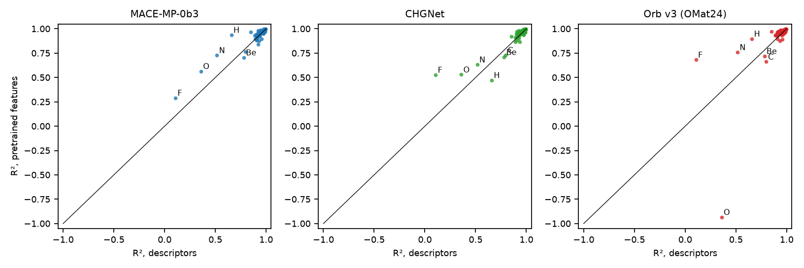
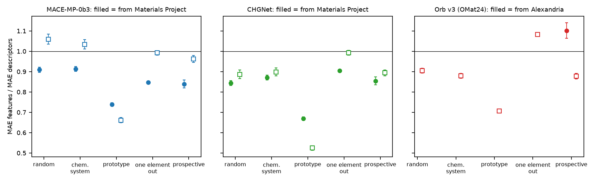

# Pretrained features

In the `cgcnn` experiment a graph network trained from scratch beat gradient boosting on descriptors wherever the elements of the test materials were known, and lost to it on compounds of an element it had never seen. Universal interatomic potentials are pretrained on hundreds of thousands to millions of DFT calculations covering nearly the whole periodic table. Used as frozen feature extractors, do they carry what a model trained on the JARVIS data alone cannot learn? Three of them (MACE-MP-0b3, CHGNet and Orb v3) describe every material by the mean and standard deviation of their atom features, and the gradient-boosting ensemble of the `uncertainty` experiment is trained on these features for all 109 of its test sets, with the same training, validation, calibration and test materials, so that the only change is the input. Because 77 % of the JARVIS materials started from a Materials Project structure, and two of the models were pretrained on Materials Project relaxations, the test materials are also split by where their structure came from. Notebook: [pretrained_features.ipynb](pretrained_features.ipynb) (or [as a web page](https://shuruyue.github.io/Materials-ML-Primer/experiments/pretrained_features/pretrained_features.html)).

## What is done

| Section | Content |
|---|---|
| 1 | Data: features of the three models for the 55 712 materials of the 2021.8.18 snapshot and the 38 190 added up to 2025.9.24; where each structure came from |
| 2 | Verification on JARVIS structures: agreement with each package's own outputs; invariance to atom order, supercells, rotations and reflections |
| 3 | Accuracy on the 109 test sets of `uncertainty` (random, chemical-system and prototype cross-validation, all 78 held-out elements, the prospective test), against the descriptors and CGCNN |
| 4 | Seen during pretraining? The gain over the descriptors for test materials from the pretraining source and from other sources |
| 5 | Orb with every structure randomly rotated, on six test sets |
| 6 | The spread of the ensemble as an uncertainty |

## Key results

**Formation-energy MAE** (eV/atom, mean over the test sets of a split; gradient-boosting ensembles on the same materials; CGCNN from the `cgcnn` experiment):

| Test set | descriptors (150) | MACE-MP-0b3 | CHGNet | Orb v3 | CGCNN ensemble | Test sets where MACE, CHGNet, Orb beat the descriptors |
|---|---|---|---|---|---|---|
| random 10-fold cross-validation | 0.088 | 0.084 | 0.075 | 0.079 | 0.056 | 10, 10, 10 of 10 |
| chemical-system groups | 0.105 | 0.100 | 0.093 | 0.093 | 0.062 | 9, 10, 10 of 10 |
| prototype groups | 0.157 | 0.111 | 0.096 | 0.111 | 0.084 | 10, 10, 10 of 10 |
| leave one element out (78 elements) | 0.160 | 0.146 | 0.148 | 0.137 | (12 elements only) | 48, 54, 61 of 78 |
| prospective (materials added after 2021) | 0.117 | 0.109 | 0.103 | 0.105 | 0.073 | 1, 1, 1 of 1 |

**The elements hardest to hold out** (R² and MAE in eV/atom of each held-out element's compounds; CGCNN from `cgcnn`):

| Element held out | Compounds | R² descriptors (150) | R² MACE-MP-0b3 | R² CHGNet | R² Orb v3 | MAE descriptors (150) | MAE MACE-MP-0b3 | MAE CHGNet | MAE Orb v3 | MAE CGCNN |
|---|---|---|---|---|---|---|---|---|---|---|
| F | 3911 | 0.11 | 0.29 | 0.53 | 0.68 | 0.747 | 0.696 | 0.548 | 0.451 | 1.238 |
| O | 14992 | 0.36 | 0.56 | 0.53 | −0.93 | 0.601 | 0.505 | 0.535 | 1.172 | 0.756 |
| N | 2789 | 0.52 | 0.73 | 0.63 | 0.76 | 0.544 | 0.402 | 0.478 | 0.387 | 0.424 |
| H | 2769 | 0.66 | 0.94 | 0.47 | 0.90 | 0.393 | 0.147 | 0.500 | 0.198 | 0.601 |
| Be | 4548 | 0.78 | 0.70 | 0.71 | 0.72 | 0.232 | 0.298 | 0.284 | 0.292 | 0.158 |
| C | 2812 | 0.80 | 0.76 | 0.73 | 0.66 | 0.276 | 0.313 | 0.364 | 0.432 | 0.392 |
| *mean over the 12 elements of `cgcnn`* | | | | | | *0.303* | *0.258* | *0.281* | *0.306* | *0.382* |
| *mean over all 78 elements* | | | | | | *0.160* | *0.146* | *0.148* | *0.137* | |

**Seen during pretraining?** MAE of the features divided by the MAE of the descriptors on the same test materials (95 % bootstrap interval), for materials whose structure came from the model's pretraining source and from other sources:

| Test set | MACE-MP-0b3: from Materials Project | other sources | CHGNet: from Materials Project | other sources | Orb v3: from Alexandria | other sources |
|---|---|---|---|---|---|---|
| random 10-fold cross-validation | 0.91 (0.90–0.92) | 1.06 (1.03–1.09) | 0.84 (0.83–0.86) | 0.89 (0.87–0.91) | – | 0.90 (0.89–0.92) |
| chemical-system groups | 0.91 (0.90–0.93) | 1.03 (1.01–1.06) | 0.87 (0.86–0.88) | 0.90 (0.88–0.92) | – | 0.88 (0.87–0.89) |
| prototype groups | 0.74 (0.73–0.75) | 0.66 (0.65–0.67) | 0.67 (0.66–0.68) | 0.52 (0.51–0.54) | – | 0.71 (0.70–0.71) |
| leave one element out (78 elements) | 0.85 (0.84–0.85) | 0.99 (0.98–1.00) | 0.90 (0.90–0.91) | 0.99 (0.98–1.00) | – | 1.08 (1.08–1.09) |
| prospective (materials added after 2021) | 0.84 (0.82–0.86) | 0.96 (0.95–0.98) | 0.85 (0.84–0.87) | 0.89 (0.88–0.91) | 1.10 (1.06–1.14) | 0.88 (0.86–0.89) |

*The 2021 snapshot has no Alexandria-sourced materials. With elements held out, the ratios pool the test materials of all 78 elements (a material appears once for each of its elements), so the oxides (14 992 compounds) dominate; Orb's 1.08 there comes from its failure on oxides.*

- **Frozen features beat the descriptors, but not a network trained on the task.** With the same gradient-boosting ensemble, the features of all three models beat the 150 descriptors on every fold of every cross-validation and on the prospective test (except one chemical-system fold for MACE): 4–14 % lower MAE on the random split, 29–39 % lower on new structure types. CGCNN trained from scratch on the same materials is better still on all these splits.
- **With an element held out, pretraining helps on average, not uniformly.** Over the 78 elements the mean MAE falls from 0.160 to 0.137–0.148 eV/atom, and the features are better on 48 (MACE), 54 (CHGNet) and 61 (Orb) of them. On the 12 elements of `cgcnn`, MACE's and CHGNet's features beat both the descriptors and CGCNN. Fluorides gain the most (R² 0.11 → 0.29, 0.53, 0.68), hydrides gain with MACE and Orb but lose with CHGNet, oxides fail with Orb (overestimated by 1.17 eV/atom on average), and Be and C compounds get worse with all three. The hard elements stay hard (Spearman 0.77–0.81 between the per-element R² of features and descriptors).
- **The gain of the MPtrj models sits on Materials Project structures.** MACE-MP-0b3's features beat the descriptors on test materials whose structure came from Materials Project and hardly or not at all on the others; CHGNet shows the same direction, less strongly. The structure-type split goes the other way, and Orb, pretrained on data derived from Alexandria, is worse than the descriptors on the Alexandria-sourced materials added after 2021. The source groups differ in what they hold (43 % of the Materials-Project-sourced materials have an ICSD entry, none of the others), so memorization cannot be told apart from a better coverage of Materials-Project-like chemistry.
- **Orb's features depend on orientation; its results hardly do.** Orb learns rotational symmetry from data instead of building it in: a rotation changes some of its features by up to 2.8 times their spread between materials, while its energy changes by at most 5 × 10⁻⁴ eV/atom. Fitted again with every structure turned, six test sets changed their MAE by 0.2–3 %.
- **The uncertainty does not improve.** The ensemble's spread ranks the errors slightly worse on the features than on the descriptors, and conformal intervals scaled by it cover about the same.

## Validation

| Quantity | This run | Check | Check from |
|---|---|---|---|
| MACE features of 30 JARVIS structures against `MACECalculator.get_descriptors` | largest difference 3.5 × 10⁻⁶ | equal up to float32 rounding | mace-torch 0.3.17 |
| CHGNet: sum of the atom features and energy against its own `crystal_fea` and energy | largest difference 1.1 × 10⁻⁵ | equal up to float32 rounding | chgnet 0.4.2 |
| Orb: energy of batched structures against its ASE calculator | largest difference 5.1 × 10⁻⁶ eV/atom | equal up to float32 rounding | orb-models 0.7.0 |
| Feature change under atom reordering, supercell, rotation, reflection (100 structures; 99th percentile, in units of the spread between materials) | MACE, CHGNet ≤ 1.2 × 10⁻⁵; Orb 5 × 10⁻⁶ (order), 2.5 × 10⁻⁵ (supercell), 0.41 (rotation), 0.42 (reflection) | 0 for an invariant model | the models' construction |

The differences at the level of float32 rounding change slightly from run to run, because the GPU adds in an unspecified order.
| Descriptor results used for comparison | identical to those of `cgcnn` and `uncertainty` | identical | `uncertainty` cache |
| Leave one element out: elements hardest for the descriptors | F, O, N, H, Be, C | F, N, H, O, Be, C hardest for gradient boosting and ALIGNN | `data_splits`; Li et al. 2024 |

No published number for gradient boosting on frozen features of these models for JARVIS formation energies was found, so the accuracy is compared with the descriptors and CGCNN of this repository on the same materials. The pytest suite run by the notebook (19 tests) checks the feature dimensions, that a structure gets the same features in a batch and alone, the invariances on small random cells, atoms without neighbors in CHGNet, and the agreement with each package's own outputs.

## Figures



*Test R² of each of the 78 held-out elements, descriptors against pretrained features (clipped at −1); above the diagonal the features do better.*



*MAE of the features divided by the MAE of the descriptors on the same test materials, for materials whose structure came from the model's pretraining source (filled; Materials Project for MACE and CHGNet, Alexandria for Orb) and from other sources (open), with 95 % bootstrap intervals. Below 1 the features do better.*

## Protocol

- **Data.** The formation energy per atom of the JARVIS-DFT 2021.8.18 snapshot and of the materials added up to 2025.9.24, as in `uncertainty`. The source of each structure is the prefix of JARVIS's `reference` field (`mp-`: Materials Project, `agm`: Alexandria, `auid-`: AFLOW, `JQE-`: not documented, `JVASP-`: JARVIS).
- **Models.** MACE-MP-0b3 medium (mace-torch 0.3.17; MIT; pretrained on MPtrj), CHGNet 0.3.0 (chgnet 0.4.2; BSD-3-Clause; MPtrj) and Orb v3 conservative with unlimited neighbors trained on OMat24 (orb-models 0.7.0; Apache-2.0; the AIMD subset of OMat24, derived from Alexandria). The weights are downloaded by each package; none are redistributed here.
- **Features.** The atom vectors that each model's energy readout reads (MACE: the scalar channels after both interactions, 256; CHGNet: after the last convolution and its layer norm, 64; Orb: the node features after the last message-passing step, 256), summarized per structure by their mean and standard deviation over the atoms (Chorna et al., arXiv:2512.05717, show that the mean alone loses information). All in float32 on the GPU, in batches of up to 2000 atoms.
- **Downstream model.** The bootstrap ensemble of five `HistGradientBoostingRegressor` models of `uncertainty` (learning rate 0.1, at most 2500 iterations, early stopping on the validation set), trained on the features instead of the 150 descriptors, with the training, validation, calibration and test materials of each of its 109 test sets.
- **Seen during pretraining.** For each split, the test materials are divided by source, and the MAE of the features is divided by the MAE of the descriptors on the same materials, with 95 % intervals from 2000 bootstrap resamples of the materials.
- **Uncertainty.** As in `uncertainty`: Spearman correlation between the ensemble's standard deviation and the absolute error, and the coverage of split conformal 90 % intervals scaled by the standard deviation.

## Differences from standard practice

The features took 28 minutes on an RTX 3060; the 333 gradient-boosting ensembles took 98 hours of process time, run as four processes of four threads on an i5-13400 (about 25 hours of wall-clock time). These choices keep it there or make the comparison possible; each is a simplification of what a full study would do.

- **Frozen features with gradient boosting.** Transfer from a pretrained potential is usually done by fine-tuning it or by training a neural readout on its features. Here the models are frozen and the downstream model is the descriptors' gradient boosting, so that the input is the only difference; fine-tuning or another readout might do better.
- **One layer, two statistics.** Only the last-layer atom features are used, summarized by their mean and standard deviation; other layers and higher cumulants were not tried.
- **One checkpoint per model.** MACE-MP-0b3 medium, CHGNet 0.3.0 and one Orb v3 variant; other sizes and versions were not tried.
- **Orb runs without TorchDynamo and in full float32.** Orb's neighbor search is wrapped in `torch.compile`, which needs Triton, and Triton is not available on Windows; TorchDynamo is switched off so that the same code runs eagerly (its energies equal those of Orb's calculator). Orb's default precision allows TF32 matrix products, which made a structure's features depend on the other structures of its batch at the 10⁻³ level; plain float32 ("float32-highest") is used instead, which is slower.
- **Orb's features are not rotation invariant.** The structures are used in the orientation JARVIS stores them; the effect of random orientations was measured on six test sets only.
- **Atoms without neighbors.** CHGNet refuses by default a structure with an atom that has no neighbor within 6 Å; 13 such atoms were kept with their embedding only.
- **Pretraining overlap inferred, not checked.** Whether a test compound is in MPtrj or OMat24 is inferred from where JARVIS took its structure; checking it would need the full pretraining data sets (several GB). The pretraining energies are PBE or PBE+U, the JARVIS targets OptB88vdW.
- **No hyperparameter search, and the iteration limit is reached.** The gradient-boosting settings are those of `uncertainty`; 37 % (MACE), 77 % (CHGNet) and 24 % (Orb) of the ensemble members reached the limit of 2500 iterations (84 % on the descriptors), so some could improve with more.
- **One assignment of materials per test set**, from `uncertainty`; the spread given is between folds or elements.
- **Fitting times are upper bounds.** Four processes shared the CPU, and when three of them had finished their share, helper processes took over the remaining jobs of the fourth; the results do not depend on which process computed them.

## Files

| File | Contents |
|---|---|
| [`materials_ml_primer/pretrained.py`](../../materials_ml_primer/pretrained.py) | the three feature extractors and the per-structure summary |
| [`tests/test_pretrained.py`](../../tests/test_pretrained.py) | pytest suite: dimensions, batching, invariances, isolated atoms, agreement with the packages |
| [`runs.py`](runs.py) | the features and the fits of every test set, cached in `data/pretrained_cache` so that a run can be split and resumed |
| [`_build/build_pretrained_features.py`](../../_build/build_pretrained_features.py) | writes the notebook |
| `pretrained_features.ipynb` | executed notebook: every number and figure above |
| `pretrained_features.html` | the same notebook as a web page |
| `pretrained_features_results.json` | the numbers of the tables, written by the notebook |
| `figures/` | figures written by the notebook |

## Run

From the repository root, after the setup in [../../README.md](../../README.md) (which installs mace-torch, chgnet and orb-models), and after the `uncertainty` experiment has filled its cache (its descriptor results are the comparison):

```bash
conda activate mmp
pytest -q tests/test_pretrained.py      # downloads the model weights on first use
cd experiments/pretrained_features
python runs.py features mace-mp-0b3      # about 5 min on an RTX 3060; also chgnet-0.3.0 (14 min), orb-v3-omat, orb-v3-omat-rotated (5 min each)
OMP_NUM_THREADS=4 python runs.py fit chgnet-0.3.0,mace-mp-0b3,orb-v3-omat,orb-v3-omat-rotated 0 4   # and 1 4, 2 4, 3 4 (about a day)
jupyter lab pretrained_features.ipynb
```

`python ../../_build/build_pretrained_features.py test.ipynb --quick` writes a version that uses only the cache and computes nothing.
