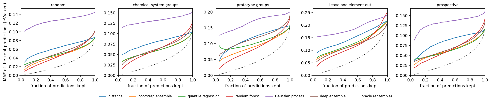
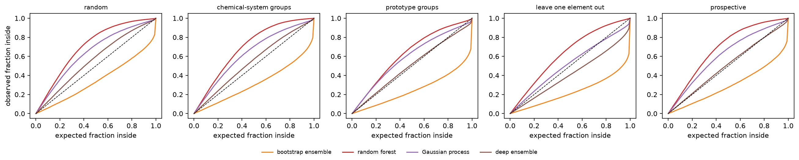
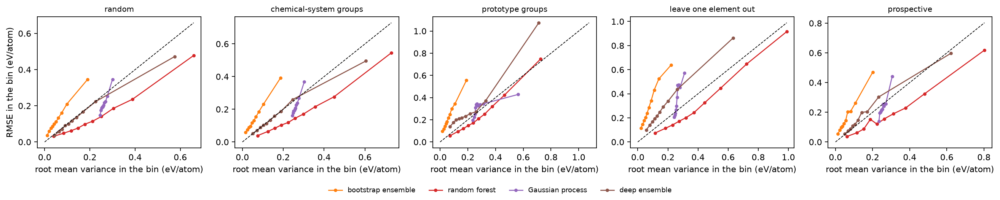
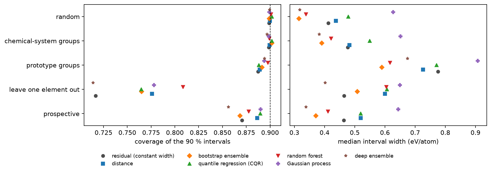
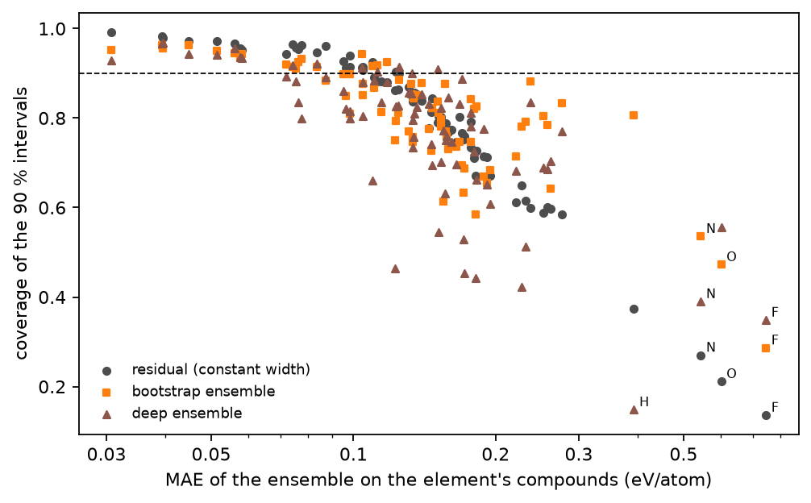

# Uncertainty

Can a materials model tell when its prediction is unreliable? The `data_splits` experiment showed that the formation-energy error grows when the test materials are unlike the training set, and that the distance to the training set flags risky regions but not risky materials. Here every prediction comes with an uncertainty from six methods (a distance, a bootstrap ensemble, quantile regression, a random forest, a Gaussian process and a deep ensemble), and each is tested on 109 test sets, from random cross-validation to unseen elements and materials computed four years later: does the uncertainty rank the errors, does it mean what it says, and do conformal intervals keep their 90 % coverage when the test data shift? Notebook: [uncertainty.ipynb](uncertainty.ipynb) (or [as a web page](https://shuruyue.github.io/Materials-ML-Primer/experiments/uncertainty/uncertainty.html)).

## What is done

| Section | Content |
|---|---|
| 1 | Verification: the coverage of split conformal prediction against its exact Beta distribution |
| 2 | Data and the 109 test sets, each with its own training, validation and calibration sets |
| 3 | Fitting the models of all test sets (cached by `runs.py`); convergence of the Gaussian process |
| 4 | Conformal intervals for every test set; fold-to-fold coverage against the beta-binomial distribution |
| 5 | Ranking: rank correlation of uncertainty and error, overlap of the largest errors, retention curves |
| 6 | Calibration of the Gaussian uncertainties: calibration curves, miscalibration area, negative log-likelihood, RMSE against root mean variance |
| 7 | Conformal coverage and width under distribution shift, overall and per element |
| 8 | Comparison with published numbers |
| 9 | Export of the results for an interactive page; summary table |

## Key results

**Conformal 90 % intervals** (seven variants: constant width, and widths scaled by each of the six uncertainties; widths in eV/atom):

| Test set | Coverage, all seven variants | Constant width: coverage, median width | Scaled by the bootstrap ensemble: coverage, median width | Highest coverage |
|---|---|---|---|---|
| random 10-fold cross-validation | 0.899–0.902 | 0.899, 0.41 | 0.899, 0.31 | 0.902 (CQR) |
| chemical-system groups | 0.897–0.902 | 0.899, 0.48 | 0.902, 0.39 | 0.902 (bootstrap ensemble, CQR) |
| prototype groups | 0.887–0.898 | 0.887, 0.78 | 0.892, 0.59 | 0.898 (random forest) |
| leave one element out (78 elements) | 0.714–0.809 | 0.717, 0.46 | 0.765, 0.51 | 0.809 (random forest) |
| prospective (materials added after 2021) | 0.856–0.890 | 0.870, 0.46 | 0.868, 0.37 | 0.890 (CQR, Gaussian process) |

**Ranking**: Spearman correlation between each uncertainty and the absolute error of the prediction it belongs to:

| Test set | distance | bootstrap ensemble | quantile regression | random forest | Gaussian process | deep ensemble |
|---|---|---|---|---|---|---|
| random 10-fold cross-validation | 0.28 | 0.54 | 0.45 | 0.64 | 0.12 | 0.57 |
| chemical-system groups | 0.22 | 0.47 | 0.45 | 0.59 | 0.11 | 0.53 |
| prototype groups | 0.23 | 0.45 | 0.42 | 0.60 | 0.17 | 0.47 |
| leave one element out (78 elements) | 0.30 | 0.48 | 0.45 | 0.61 | 0.21 | 0.48 |
| *the same, median over the 78 elements* | *0.08* | *0.27* | *0.32* | *0.43* | *0.02* | *0.40* |
| prospective (materials added after 2021) | 0.25 | 0.49 | 0.47 | 0.61 | 0.14 | 0.53 |
| *MAE of the prediction, random split (eV/atom)* | *0.088* | *0.088* | *0.088* | *0.106* | *0.146* | *0.105* |

**Calibration of the stated standard deviations**: share of the test materials inside the 90 % Gaussian interval, as stated → after std scaling (one factor per test set, fitted on its calibration set):

| Test set | bootstrap ensemble | random forest | Gaussian process | deep ensemble |
|---|---|---|---|---|
| random 10-fold cross-validation | 68 % → 93 % | 98 % → 93 % | 95 % → 92 % | 93 % → 92 % |
| chemical-system groups | 62 % → 93 % | 99 % → 92 % | 95 % → 92 % | 92 % → 92 % |
| prototype groups | 51 % → 92 % | 95 % → 92 % | 91 % → 91 % | 87 % → 91 % |
| leave one element out (78 elements) | 46 % → 82 % | 97 % → 84 % | 86 % → 81 % | 76 % → 75 % |
| prospective (materials added after 2021) | 59 % → 92 % | 98 % → 89 % | 94 % → 91 % | 88 % → 89 % |
| *miscalibration area, random split (as stated → scaled)* | *0.147 → 0.116* | *0.205 → 0.066* | *0.143 → 0.087* | *0.065 → 0.048* |
| *scale factor (median over the test sets of a split), range over the splits* | *2.54–3.80* | *0.55–0.82* | *0.81–0.99* | *0.95–1.12* |

- **Conformal intervals hold where calibration and test data are drawn alike, and only there.** On the random split all 70 fold coverages lie inside the range the theory allows for exchangeable data, and the chemical-system split gives the same coverage. With structure types held out the coverage dips slightly and varies much more from fold to fold (21 of 70 fold coverages inside that range), because a structure type behaves like one large correlated unit. On the materials added after 2021 it falls to 0.86–0.89, and with an element held out to 0.71–0.81, down to 0.14 for fluorine compounds with intervals of constant width (O 0.21, N 0.27, H 0.37: the elements that `data_splits` found hardest to predict).
- **Scaling the intervals by an uncertainty makes them narrower at the same coverage and loses less coverage under shift, without closing the gap.** The median width on the random split falls from 0.41 to 0.31 eV/atom with the bootstrap ensemble; with an element held out, intervals scaled by the random forest cover 0.81 against 0.72 for constant width.
- **The random forest's spread ranks the errors best, and ranking hardly suffers when the test set shifts, except within an unseen element.** From the random to the chemical-system, prototype and prospective splits the correlations change by at most 0.1 (retention gain of the forest 0.73–0.78). The pooled leave-one-element-out correlations are of the same size, but mostly because some elements are harder than others: within the compounds of one element the median correlation drops to 0.43 for the forest, 0.40 for the deep ensemble and 0.08 for the distance.
- **The best ranking does not come with the best prediction.** The forest's own predictions have a 20 % larger error than the gradient-boosting ensemble's, and once more than 42 % (chemical systems) to 80 % (unseen elements) of the predictions are kept, the forest's kept predictions are worse than the ensemble's.
- **Stated standard deviations are rarely right as they come.** The bootstrap ensemble is 2.5 to 3.8 times too confident (as Palmer et al. 2022 found for bootstrap ensembles of materials models), the random forest too cautious. The Gaussian process is right on average but its standard deviation hardly varies between materials, so it ranks poorly (Spearman 0.11–0.21). The deep ensemble is the best calibrated without correction (miscalibration area 0.013–0.065 on four splits; 0.078 for a MEGNet ensemble on Materials Project in Varivoda et al. 2023). One scale factor fixes the scale on every split but leave one element out.
- **Confidently wrong.** In the prototype split, one structure type (1402 ABC₄ compounds of space group F-43m on the Wyckoff positions of the MgCu₄Sn type, 2.5 % of them with an ICSD entry, mean formation energy +0.58 against −0.83 eV/atom for the whole snapshot) is predicted 4.5 times worse than the rest by the ensemble (0.65 eV/atom; 0.48–0.65 for all models). The forest puts its uncertainty at the 83rd percentile, but the deep ensemble and quantile regression at the 22nd and 25th: more confident than for a typical material.
- **Point predictions.** The ensemble's error on the random split (0.088 eV/atom) is larger than in `data_splits` (0.076) because it trains on 70 % instead of 80 % of the data, with a faster learning rate.

## Validation

| Quantity | This run | Check | Check from |
|---|---|---|---|
| Coverage of split conformal intervals for 4000 simulated calibration sets of 200 points | mean 0.9004; Kolmogorov–Smirnov p = 0.28 against Beta(181, 20) | mean between 0.900 and 0.905; Beta(181, 20) | Vovk 2012; Angelopoulos & Bates (theory) |
| Random split: coverage of every fold and conformal variant | 70 of 70 inside the 99.9 % beta-binomial range (0.881–0.918) | 70 of 70 | exchangeability (theory) |
| Leave one element out: lowest coverage of constant-width intervals | F 0.14, O 0.21, N 0.27, H 0.37, C 0.58, B 0.59 | hardest elements to predict: F, N, H, O, Be, C | `data_splits`; Li et al. 2024 |
| Miscalibration area of an ensemble, formation energy, random split | 0.065 (deep ensemble), 0.147 (bootstrap ensemble of gradient boosting) | 0.078 (MEGNet ensemble, Materials Project) | Varivoda et al. 2023 (context: other model and data) |
| Spearman correlation of uncertainty and error, formation energy | 0.12–0.64 (random split; distance 0.28) | 0.12–0.27 (MEGNet, conformal); 0.12–0.22 (12 graph networks, out-of-distribution perovskites) | Varivoda et al. 2023; MatUQ, arXiv:2511.11697 (context) |
| Bootstrap standard deviations | 2.5–3.8 times too small | raw bootstrap standard deviations of materials models inaccurate, recalibration needed | Palmer et al. 2022 (qualitative) |
| Ensemble MAE, random split | 0.088 eV/atom (70 % training data, learning rate 0.1) | 0.076 eV/atom (80 %, 0.05) | `data_splits` |

The pytest suite run by the notebook (16 tests) checks the rank of the conformal threshold and the parameters of its Beta distribution, the conditional coverage against that distribution (Kolmogorov–Smirnov), the coverage of normalized and CQR intervals on heteroscedastic data, the miscalibration area against a closed form, the negative log-likelihood against SciPy, RMSE = RMV for calibrated data, the moments of a Gaussian mixture, the scale factor of std scaling, the retention curves and rank metrics, and every model on synthetic data with a known noise level.

## Figures



*MAE of the predictions kept when the most uncertain ones are rejected, for each method and test set; each curve uses the method's own prediction. Dotted: rejecting by the true error of the ensemble. The Gaussian process lies higher because its predictions are less accurate.*



*Fraction of the test materials inside central Gaussian intervals of the stated standard deviation, against the stated fraction. On the dashed diagonal a standard deviation means what it says; below it the method is overconfident (bootstrap ensemble), above it too cautious (random forest).*



*RMSE against the root mean variance in ten bins of equal size, sorted by the stated standard deviation (Levi et al. 2022). Apart from one bin in the prototype split, the bins of the Gaussian process span a narrow range of stated standard deviations: its uncertainty hardly tells materials apart.*



*Coverage (left) and median width (right) of the 90 % conformal intervals of the seven variants. The coverage holds where calibration and test sets are drawn alike and falls when elements are held out and for the materials added later.*



*Coverage of three conformal variants for each held-out element, against the ensemble's MAE on that element's compounds; the three lowest of each variant are labeled.*

## Protocol

- **Data and features.** The formation energy per atom of the JARVIS-DFT 2021.8.18 snapshot (55 712 materials) and of the 38 190 materials added up to 2025.9.24, with the 150 composition and structure features of the `baselines` experiment. The Gaussian process and the networks get these features with missing values replaced by the training median and standardized with the training mean and standard deviation.
- **Test sets.** Each test set has its own training set, a validation set used only for early stopping, and a calibration set used only for conformal prediction (so that the calibration scores are exchangeable with the test scores whenever the test set is drawn like the calibration set).
  - *Cross-validation* with the random, chemical-system and prototype folds of `data_splits` (10 folds each): fold *k* is the test set, *k* + 1 the validation set, *k* + 2 the calibration set and the other seven folds the training set (70/10/10/10).
  - *Leave one element out* for the 78 elements in at least 200 materials, and the *prospective* test (trained on 2021, tested on the materials added later): the remaining materials are split by chemical system into training, validation and calibration sets (80/10/10).
  - *Why these proportions.* Sesia & Candès (Stat 2020, arXiv:1909.05433) varied the share of the data used for training against calibration on twelve data sets and found that 70–90 % for training worked best; training gets 7/9 = 78 % of the non-test data in cross-validation and 80 % otherwise. The coverage of split conformal intervals given one calibration set of *n* points follows Beta(*n* + 1 − *l*, *l*), *l* = ⌊(*n* + 1)α⌋; Angelopoulos & Bates (arXiv:2107.07511, Table 1) need about 2500 calibration points for a coverage within ±1 % of the target with probability 0.9. The calibration sets here hold about 5500 materials.
- **Models.**
  - *Bootstrap ensemble*: five `HistGradientBoostingRegressor` models (the tree settings of the baselines: 63 leaves; learning rate 0.1, at most 2500 iterations, early stopping after 100 iterations without improvement on the validation set), each trained on a bootstrap resample of the training set; prediction: their mean; uncertainty: their standard deviation.
  - *Quantile regression*: two gradient-boosting models with the pinball loss for the 5 % and 95 % quantiles, same settings; uncertainty: the width of the band.
  - *Random forest*: 300 trees with one third of the features per split (as in the baselines); uncertainty: the standard deviation of the trees.
  - *Distance*: the mean standardized distance to the five nearest training materials, as in `data_splits`; it is paired with the prediction of the bootstrap ensemble.
  - *Gaussian process*: a sparse variational GP (Hensman et al. 2013; GPyTorch) with an ARD RBF kernel, a constant mean and 1024 inducing points started at distinct training materials and then learned; Adam, learning rate 0.01, batches of 1024, 60 epochs, keeping the epoch with the lowest validation negative log-likelihood. Its standard deviation includes the Gaussian noise.
  - *Deep ensemble* (Lakshminarayanan et al. 2017): five networks with two hidden layers of 256 SiLU units that each predict a mean and a variance, trained with the Gaussian negative log-likelihood (Adam, learning rate 0.001, batches of 512, early stopping on the validation set after 20 epochs without improvement, at most 200 epochs); the ensemble is the equal-weight mixture of the five Gaussians.
- **Conformal prediction.** Split conformal with α = 0.1: the threshold is the ⌈(*n* + 1)(1 − α)⌉-th smallest of the *n* calibration scores. Scores: the absolute residual (an interval of constant width); the absolute residual divided by an uncertainty (normalized intervals, one per method); max(lo − *y*, *y* − hi) for conformalized quantile regression (Romano et al. 2019).
- **Metrics.** Ranking: the Spearman correlation between uncertainty and absolute error, the share of the 10 % largest errors among the 10 % most uncertain predictions (10 % by chance), and the retention curve (the MAE of the predictions kept when the most uncertain ones are rejected), summarized by the retention gain (the area between the curve of a random order and that of the method, divided by the same area for the order of the errors themselves: 1 for a perfect ranking, 0 for a random one). Calibration of the methods with a Gaussian standard deviation: the miscalibration area (Tran et al. 2020; the area between the observed and the stated fraction of errors inside central Gaussian intervals, 0 to 0.5), the Gaussian negative log-likelihood, and the RMSE against the root mean variance in ten bins of equal size (Levi et al. 2022). Conformal intervals: coverage and median width.

## Differences from standard practice

The full run fits about 1500 models (14 per test set) on one desktop computer, an i5-13400 and an RTX 3060, in about 15 hours of computing (11 hours with the CPU and GPU parts running at the same time); these choices keep it there. Each is a simplification of what a full study would do, and the numbers above should be read with them in mind.

- **No hyperparameter search.** All models use fixed, common settings; none were tuned per method or per split, so a tuned method might rank or calibrate better.
- **A faster learning rate, and the iteration limit is reached.** The gradient-boosting models use a learning rate of 0.1 with at most 2500 iterations (the baselines and `data_splits` used 0.05 and 5000), which cut the fitting time per model from 30–65 s to about 20 s. Early stopping does not trigger for 84 % of the ensemble members (printed by the notebook) and for 3 of the 218 quantile models (1.4 %, counted from the cached fits), so these models could improve slightly with more iterations.
- **Five ensemble members.** The bootstrap and deep ensembles have five members each, the number used by Lakshminarayanan et al. (2017); larger ensembles give a less noisy standard deviation.
- **An approximate Gaussian process.** An exact GP on about 40 000 materials works with a 40 000 × 40 000 kernel matrix (6.4 GB in single precision) at every step of its training, too slow for 109 fits here; the sparse variational approximation with 1024 inducing points and 60 epochs is a compromise. On the first random fold, 2048 inducing points improved the rank correlation from 0.10 to 0.12 at four times the cost (the notebook repeats this comparison).
- **A small jitter.** To keep the Cholesky factorization of the GP stable in single precision, 10⁻⁴ is added to the diagonal of the kernel matrix (GPyTorch's default is 10⁻⁶).
- **Deep ensemble without adversarial training.** Lakshminarayanan et al. also trained on adversarial examples; that step is left out.
- **One fold assignment, single runs.** Each task is one fit with fixed seeds; the spread given is between folds and elements, not between repeated runs.
- **Split conformal only, marginal coverage only.** Cross-conformal and jackknife+ (Barber et al. 2021) use the data more efficiently but need many more fits. The guarantee is on the average coverage over the test set, not for each material or each kind of material.
- **The calibration data are not shifted.** For leave one element out and the prospective test, the calibration set is drawn from the same materials as the training set, so it is not exchangeable with the test set and the coverage guarantee does not hold by construction: these test sets measure how far coverage falls under a realistic shift, which is the point of including them.
- **Fitting times.** The two parts of `runs.py` ran at the same time on one computer and slowed each other down for part of the run, and the time of one GPU task (leave out Ca) includes a 26-minute pause of that part; the times printed in the notebook are therefore upper bounds.

## Files

| File | Contents |
|---|---|
| [`materials_ml_primer/uncertainty.py`](../../materials_ml_primer/uncertainty.py) | split conformal prediction (residual, normalized, CQR) and its Beta distribution, the metrics, and the models (bootstrap ensemble, quantile pair, random forest, sparse variational GP, deep ensemble) |
| [`tests/test_uncertainty.py`](../../tests/test_uncertainty.py) | pytest suite: conformal rank and coverage against exact results, metrics against closed forms and SciPy, and the models on synthetic data with known noise |
| [`runs.py`](runs.py) | the 109 test sets and the fitting of every model, cached in `data/uncertainty_cache` so that a run can be split and resumed |
| [`_build/build_uncertainty.py`](../../_build/build_uncertainty.py) | writes the notebook |
| `uncertainty.ipynb` | executed notebook: every number and figure above |
| `uncertainty.html` | the same notebook as a web page |
| `uncertainty_results.json` | the numbers behind the figures, written by the notebook |
| `figures/` | figures written by the notebook |

## Run

From the repository root, after the setup in [../../README.md](../../README.md):

```bash
conda activate mmp
pytest -q tests/test_uncertainty.py
cd experiments/uncertainty
python runs.py cpu     # gradient boosting, quantile regression, random forest, distance (about 5-6 h)
python runs.py gpu     # Gaussian process and deep ensemble (about 9 h on an RTX 3060)
jupyter lab uncertainty.ipynb
```

The notebook computes whatever is not cached, so it can also be run directly, but then everything runs one after the other. `python runs.py cpu` and `python runs.py gpu` can run at the same time in two terminals. `python ../../_build/build_uncertainty.py test.ipynb --quick` writes a version that uses only the cached tasks and fits nothing.
